The best YouTube autocomplete keyword tool depends on the job: SellonTube (our tool) for buyer-intent priority, Pemavor for free bulk suggestions, RyRob for free volume estimates, and KeywordTool.io for the largest raw keyword count. We make the SellonTube tool, and we rank it #1. Every price, limit, and feature for the other 10 tools comes from the vendor's own page, and every rating links to its listing.

You type "crm for small business" into YouTube's search bar. Eight suggestions appear. You jot them down, then type "crm for small business a," then "b," then "c." Twenty minutes later you have 40 keywords in a messy spreadsheet and no way to tell which ones attract buyers and which attract browsers.

YouTube autocomplete keyword tools run those variations for you. The better ones also sort each suggestion by search intent, so you know which keywords to film first. The 11 tools here are judged on four criteria that matter for business channels rather than creator channels.

<strong>Last updated: October 2026.</strong> Method: each tool is compared on the four criteria below (instant access, suggestion volume, export, and extra data such as intent tags). Prices, limits, and features come from each vendor's own pages; SellonTube's features come from the tool's source code. Ratings are real third-party ratings with the platform linked; where a tool has no rating listing, we say so.

<figure style="margin: 2rem 0;">
  

    <iframe src="https://www.youtube-nocookie.com/embed/0e1mAGNowyk" title="Discover keyword ideas with YouTube Autocomplete" loading="lazy" allow="accelerometer; clipboard-write; encrypted-media; gyroscope; picture-in-picture; web-share" allowfullscreen style="position: absolute; inset: 0; width: 100%; height: 100%; border: 0;"></iframe>
  

  <figcaption style="font-size: 0.85rem; color: #64748b; margin-top: 0.5rem; text-align: center;">Video: mining YouTube autocomplete for keyword ideas (SEO PowerSuite). A quick visual primer before the tool-by-tool breakdown.</figcaption>
</figure>

Key Takeaways

<ul style="margin: 0; padding-left: 1.25rem;">
<li style="margin-bottom: 0.5rem; color: #334155; font-size: 0.9rem;">YouTube autocomplete shows the exact phrases people type on YouTube. It tells you a phrase is searched, not how often.</li>
<li style="margin-bottom: 0.5rem; color: #334155; font-size: 0.9rem;">Intent decides which keyword earns leads. "Best CRM for startups" (comparison) attracts a buyer; "what is a CRM" (research) attracts a learner.</li>
<li style="margin-bottom: 0.5rem; color: #334155; font-size: 0.9rem;">Free tiers differ on the limits that matter: Keyword Tool Dominator allows 2 free searches a day, YouAutoCompleteMe pauses you after 15-20 small searches, and KeywordTool.io keeps volume data on its paid plans.</li>
<li style="margin-bottom: 0.5rem; color: #334155; font-size: 0.9rem;">The <a href="/tools/youtube-autocomplete-keywords">SellonTube YouTube Autocomplete Keyword Tool</a> (our tool) gives every keyword a High, Medium, or Low buyer-intent priority and groups the full list into video topics. The quick preview is free with no signup; the full list and CSV cost an email address.</li>
<li style="margin-bottom: 0.5rem; color: #334155; font-size: 0.9rem;">Developer scrapers (Botster, Apify) go deepest but need an account and paid credits. They suit agencies processing autocomplete data at scale.</li>
<li style="margin-bottom: 0; color: #334155; font-size: 0.9rem;">Pair autocomplete data with a <a href="/tools/youtube-seo-tool">YouTube SEO tool</a> to check whether your existing videos match the phrases buyers actually search.</li>
</ul>

| Tool | Best for | Key strength | Price |
|------|----------|--------------|-------|
| **SellonTube** (our tool) | Buyer-intent keywords for a business channel | High/Medium/Low intent priority + AI video-topic clusters | Free; email for full list + CSV |
| Pemavor | Free bulk suggestions | Unlimited searches, 4 sources, CSV | Free, no account |
| RyRob | Free volume estimates | YouTube search volume + difficulty | Free, no signup |
| KeywordTool.io | Largest raw keyword count | 750+ suggestions per search | Free; paid from $88/mo or $68/mo annual (keywordtool.io, 2026) |
| Keyword Tool Dominator | Scored keywords without a subscription | Popularity Score 0-100 | 2 free searches/day; one-time from $9 for 30 days (keywordtooldominator.com, 2026) |

## Contents

- [What to Look For in a YouTube Autocomplete Keyword Tool](#what-to-look-for-in-a-youtube-autocomplete-keyword-tool)
- [Comparison Table: YouTube Autocomplete Keyword Tools](#comparison-table-youtube-autocomplete-keyword-tools)
- [The 11 Best YouTube Autocomplete Keyword Tools](#the-11-best-youtube-autocomplete-keyword-tools)
  - [SellonTube YouTube Autocomplete Keyword Tool](#1-sellontube-youtube-autocomplete-keyword-tool)
  - [KeywordTool.io](#2-keywordtoolio)
  - [Pemavor Autocomplete Tool](#3-pemavor-autocomplete-tool)
  - [Keyword Tool Dominator](#4-keyword-tool-dominator)
  - [Keyword.io](#5-keywordio)
  - [RyRob YouTube Keyword Tool](#6-ryrob-youtube-keyword-tool)
  - [YouAutoCompleteMe](#7-youautocompleteme)
  - [Ahrefs YouTube Keyword Tool](#8-ahrefs-youtube-keyword-tool)
  - [SemanticPen](#9-semanticpen)
  - [Botster YouTube Keyword Scraper](#10-botster-youtube-keyword-scraper)
  - [Apify YouTube Autocomplete Scrapers](#11-apify-youtube-autocomplete-scrapers)
- [How to Find Great Keywords Using YouTube Autocomplete](#how-to-find-great-keywords-using-youtube-autocomplete)
- [How to Choose the Right YouTube Autocomplete Tool](#how-to-choose-the-right-youtube-autocomplete-tool)
- [Why Aren't vidIQ and TubeBuddy on This List?](#why-arent-vidiq-and-tubebuddy-on-this-list)
- [What the Free Tools Save You vs the Paid Ones](#what-the-free-tools-save-you-vs-the-paid-ones)
- [Which Autocomplete Tool for Your Situation: A Cheat Sheet](#which-autocomplete-tool-for-your-situation-a-cheat-sheet)
- [What to Do This Week](#what-to-do-this-week)
- [FAQ](#faq)

---

## What to Look For in a YouTube Autocomplete Keyword Tool

**A YouTube autocomplete keyword tool** is a tool that queries YouTube's search suggestion endpoint for a seed keyword and returns the long-tail phrases real users type. Volume-based keyword tools estimate demand from their own data; autocomplete tools show the exact queries YouTube suggests to searchers.

A good YouTube autocomplete keyword tool does three jobs: it expands your seed with a to z letters and intent modifiers such as "best," "vs," or "mistakes," it separates buyer queries from browser queries, and it exports the result so the list moves into your content plan. The SellonTube YouTube Autocomplete Keyword Tool is the pick when the second job matters most, because it gives every suggestion a High, Medium, or Low buyer-intent priority. Its quick scrape sends 27 queries to YouTube (your seed plus each letter from a to z), and its full scrape adds 34 buyer-intent modifiers, three of them run before and after the seed, for 64 queries in total, per the tool's source code. Pemavor and RyRob are the free picks when you only need raw suggestions or volume estimates. KeywordTool.io returns the most raw suggestions per search. For a B2B YouTube channel, the intent layer decides which keywords become your next buyer-intent video.

Four criteria separate a useful tool from a toy.

<svg viewBox="0 0 800 160" width="100%" style="max-width: 800px; margin: 1.5rem auto; display: block;" role="img" aria-label="Four-step autocomplete keyword workflow: Enter seed keyword, A-Z plus modifier expansion, intent categorization, export and plan">
  <defs>
    <marker id="arrowG" markerWidth="8" markerHeight="6" refX="8" refY="3" orient="auto">
      <path d="M0,0 L8,3 L0,6" fill="#10b981"/>
    </marker>
  </defs>
  <rect x="0" y="0" width="800" height="160" rx="16" fill="#f8fafc" stroke="#e2e8f0" stroke-width="1.5"/>
  <text x="400" y="24" text-anchor="middle" fill="#94a3b8" font-family="Inter,system-ui,sans-serif" font-size="10" font-weight="700" letter-spacing="0.1em">HOW AUTOCOMPLETE KEYWORD TOOLS WORK</text>
  <rect x="20" y="42" width="160" height="96" rx="12" fill="#ecfdf5" stroke="#10b981" stroke-width="1.5"/>
  <text x="100" y="78" text-anchor="middle" fill="#064e3b" font-family="Inter,system-ui,sans-serif" font-size="24">&#x1F50D;</text>
  <text x="100" y="102" text-anchor="middle" fill="#064e3b" font-family="Inter,system-ui,sans-serif" font-size="12" font-weight="700">1. Seed keyword</text>
  <text x="100" y="118" text-anchor="middle" fill="#065f46" font-family="Inter,system-ui,sans-serif" font-size="10">"crm for small business"</text>
  <line x1="185" y1="90" x2="210" y2="90" stroke="#10b981" stroke-width="2" marker-end="url(#arrowG)"/>
  <rect x="215" y="42" width="160" height="96" rx="12" fill="#ecfdf5" stroke="#10b981" stroke-width="1.5"/>
  <text x="295" y="78" text-anchor="middle" fill="#064e3b" font-family="Inter,system-ui,sans-serif" font-size="24">&#x1F524;</text>
  <text x="295" y="102" text-anchor="middle" fill="#064e3b" font-family="Inter,system-ui,sans-serif" font-size="12" font-weight="700">2. A-Z + modifiers</text>
  <text x="295" y="118" text-anchor="middle" fill="#065f46" font-family="Inter,system-ui,sans-serif" font-size="10">dozens of suggest queries</text>
  <line x1="380" y1="90" x2="405" y2="90" stroke="#10b981" stroke-width="2" marker-end="url(#arrowG)"/>
  <rect x="410" y="42" width="170" height="96" rx="12" fill="#ecfdf5" stroke="#10b981" stroke-width="1.5"/>
  <text x="495" y="78" text-anchor="middle" fill="#064e3b" font-family="Inter,system-ui,sans-serif" font-size="24">&#x1F3AF;</text>
  <text x="495" y="102" text-anchor="middle" fill="#064e3b" font-family="Inter,system-ui,sans-serif" font-size="12" font-weight="700">3. Intent tagging</text>
  <text x="495" y="118" text-anchor="middle" fill="#065f46" font-family="Inter,system-ui,sans-serif" font-size="10">High / Medium / Low priority</text>
  <line x1="585" y1="90" x2="610" y2="90" stroke="#10b981" stroke-width="2" marker-end="url(#arrowG)"/>
  <rect x="615" y="42" width="165" height="96" rx="12" fill="#ecfdf5" stroke="#10b981" stroke-width="1.5"/>
  <text x="697" y="78" text-anchor="middle" fill="#064e3b" font-family="Inter,system-ui,sans-serif" font-size="24">&#x1F4CA;</text>
  <text x="697" y="102" text-anchor="middle" fill="#064e3b" font-family="Inter,system-ui,sans-serif" font-size="12" font-weight="700">4. Export + plan</text>
  <text x="697" y="118" text-anchor="middle" fill="#065f46" font-family="Inter,system-ui,sans-serif" font-size="10">CSV with metadata</text>
</svg>

### Instant access

Instant access means you paste a keyword and see results without an account, a card, or API credentials. Every extra step before the first keyword is friction you pay on every research session.

### Suggestion volume

Suggestion volume is how far the tool expands one seed. A tool that returns 10 keywords is a demo. Look for a to z prefixes and suffixes plus intent modifiers, which turn one seed into a real dataset.

### Export and copy

Export decides whether the keywords reach your content plan. You need a CSV download or a copy-all button at minimum, and the export should carry metadata such as intent tags, geography, or a timestamp.

### Buyer-intent tagging and other extra data

**Buyer-intent tagging** is sorting each keyword by how close the searcher is to a purchase, so comparison, pricing, and mistakes searches rank above definitions. Volume estimates and popularity scores are the other kinds of extra data. Raw autocomplete tells you what people search; the extra data tells you which keyword to film first. Pair the shortlist with the [tag generator tool](/tools/youtube-tag-generator) to turn it into ready-to-use metadata.

Here is the manual process next to an autocomplete tool:

**The manual way:** open YouTube, type a keyword, write down 8 suggestions. Repeat with 10 variations. In our experience that takes about 30 minutes for 80 keywords, with no way to rank them.

**With a tool:** enter one seed keyword, let the tool run the a to z and modifier queries, then sort the export by priority. Pick three High-intent keywords and start filming.

## Comparison Table: YouTube Autocomplete Keyword Tools

The comparison table below puts all 11 YouTube autocomplete keyword tools side by side on price, signup, output size, extra data, and export.

| Tool | Free? | Signup? | Keywords/query | Extra data | Export |
|------|-------|---------|----------------|------------|-------|
| **SellonTube** (our tool) | Yes | Email for full list | Preview free; full list after email | Intent tags + priority, AI clusters | CSV (after email) |
| KeywordTool.io | Freemium | No | 750+ | Paid only ($88/mo, or $68/mo billed annually) | CSV (paid) |
| Pemavor | Yes | No | Unlimited searches | N-gram topics, browse by intent | CSV |
| Keyword Tool Dominator | Freemium | No (2 free searches/day) | Limited free | Popularity Score, hot flags | Paid plans |
| Keyword.io | Yes | Account for saved lists | Hundreds | No | Not stated |
| RyRob | Yes | No | Dozens | Volume + difficulty | Limited |
| YouAutoCompleteMe | Yes | No | 10-15 | No | Not stated |
| Ahrefs | Freemium | No | Tool under maintenance | Volume | n/a |
| SemanticPen | Freemium | Yes | Standard | No | CSV |
| Botster | Paid | Yes | Multi-depth | No | Yes |
| Apify | Paid | Yes | Variable | No | API dataset |

## The 11 Best YouTube Autocomplete Keyword Tools

The 11 tools are ranked by how well each one serves a business channel that wants buyer-intent keywords, then by how much free access it gives. Our own tool sits at #1 on that criterion, and every entry lists its limits.

### 1. SellonTube YouTube Autocomplete Keyword Tool

<figure style="margin: 1.5rem 0;">

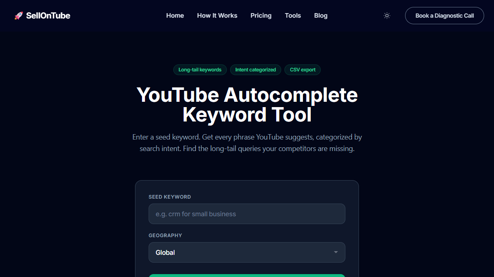

<figcaption style="font-size: 0.85rem; color: #64748b; margin-top: 0.5rem; text-align: center;">SellonTube tool input: a seed keyword plus a 19-country geography menu.</figcaption>
</figure>

**Best for:** Business owners and agencies who need buyer-intent keyword lists from YouTube autocomplete.

SellonTube's [YouTube Autocomplete Keyword Tool](/tools/youtube-autocomplete-keywords) (our tool) queries YouTube's suggestion endpoint in two steps. The quick scrape sends 27 queries: your seed plus each letter from a to z. It needs no signup and shows a preview of up to 3 keywords per intent category, plus the total count it found.

The full scrape runs after you enter an email address. It adds 34 buyer-intent modifiers ("best," "vs," "alternatives to," "mistakes," "pricing," "worth it," and more), three of them run before and after the seed, for 64 queries in total. It then removes duplicates and off-topic noise.

Every keyword lands in one of five intent categories, each with a business priority.

<svg viewBox="0 0 700 290" width="100%" style="max-width: 700px; margin: 1rem auto; display: block;" role="img" aria-label="Five intent categories ranked by business value: Comparison and Evaluation (High), Mistakes and Red Flags (High), Results and Proof (High), How-To and Problem-Solving (Medium), Research and Discovery (Low)">
  <rect x="0" y="0" width="700" height="290" rx="14" fill="#f8fafc" stroke="#e2e8f0" stroke-width="1.5"/>
  <text x="350" y="26" text-anchor="middle" fill="#94a3b8" font-family="Inter,system-ui,sans-serif" font-size="10" font-weight="700" letter-spacing="0.1em">INTENT CATEGORIES RANKED BY BUSINESS VALUE</text>
  <rect x="16" y="42" width="668" height="42" rx="8" fill="#ecfdf5" stroke="#10b981" stroke-width="1.5"/>
  <text x="30" y="68" fill="#064e3b" font-family="Inter,system-ui,sans-serif" font-size="13" font-weight="700">Comparison &amp; Evaluation</text>
  <text x="580" y="68" text-anchor="end" fill="#065f46" font-family="Inter,system-ui,sans-serif" font-size="11">best, vs, alternatives, pricing, review</text>
  <rect x="634" y="52" width="42" height="22" rx="6" fill="#dc2626"/>
  <text x="655" y="67" text-anchor="middle" fill="#ffffff" font-family="Inter,system-ui,sans-serif" font-size="10" font-weight="700">HIGH</text>
  <rect x="16" y="90" width="668" height="42" rx="8" fill="#fffbeb" stroke="#f59e0b" stroke-width="1.5"/>
  <text x="30" y="116" fill="#78350f" font-family="Inter,system-ui,sans-serif" font-size="13" font-weight="700">Mistakes &amp; Red Flags</text>
  <text x="580" y="116" text-anchor="end" fill="#92400e" font-family="Inter,system-ui,sans-serif" font-size="11">mistakes, avoid, wrong, scam, worst</text>
  <rect x="634" y="100" width="42" height="22" rx="6" fill="#dc2626"/>
  <text x="655" y="115" text-anchor="middle" fill="#ffffff" font-family="Inter,system-ui,sans-serif" font-size="10" font-weight="700">HIGH</text>
  <rect x="16" y="138" width="668" height="42" rx="8" fill="#faf5ff" stroke="#a855f7" stroke-width="1.5"/>
  <text x="30" y="164" fill="#581c87" font-family="Inter,system-ui,sans-serif" font-size="13" font-weight="700">Results &amp; Proof</text>
  <text x="580" y="164" text-anchor="end" fill="#6b21a8" font-family="Inter,system-ui,sans-serif" font-size="11">results, case study, ROI, before and after</text>
  <rect x="634" y="148" width="42" height="22" rx="6" fill="#dc2626"/>
  <text x="655" y="163" text-anchor="middle" fill="#ffffff" font-family="Inter,system-ui,sans-serif" font-size="10" font-weight="700">HIGH</text>
  <rect x="16" y="186" width="668" height="42" rx="8" fill="#eff6ff" stroke="#3b82f6" stroke-width="1.5"/>
  <text x="30" y="212" fill="#1e3a5f" font-family="Inter,system-ui,sans-serif" font-size="13" font-weight="700">How-To &amp; Problem-Solving</text>
  <text x="580" y="212" text-anchor="end" fill="#1e40af" font-family="Inter,system-ui,sans-serif" font-size="11">how to, tutorial, setup, for beginners</text>
  <rect x="630" y="196" width="50" height="22" rx="6" fill="#2563eb"/>
  <text x="655" y="211" text-anchor="middle" fill="#ffffff" font-family="Inter,system-ui,sans-serif" font-size="10" font-weight="700">MED</text>
  <rect x="16" y="234" width="668" height="42" rx="8" fill="#f8fafc" stroke="#94a3b8" stroke-width="1.5"/>
  <text x="30" y="260" fill="#334155" font-family="Inter,system-ui,sans-serif" font-size="13" font-weight="700">Research &amp; Discovery</text>
  <text x="580" y="260" text-anchor="end" fill="#64748b" font-family="Inter,system-ui,sans-serif" font-size="11">what is, why, should I, can you</text>
  <rect x="632" y="244" width="46" height="22" rx="6" fill="#94a3b8"/>
  <text x="655" y="259" text-anchor="middle" fill="#ffffff" font-family="Inter,system-ui,sans-serif" font-size="10" font-weight="700">LOW</text>
</svg>

The priority tag tells you which keywords attract viewers closest to a purchase decision. Comparison keywords can feed pipeline this quarter. Research keywords build authority over time. You need both, but the order you film them in decides how fast you see results.

**Why search intent matters for a YouTube acquisition channel:** a buyer-intent keyword like "best CRM for startups" or "CRM mistakes to avoid" attracts viewers weighing a purchase, so a video built on it can bring in qualified leads. An informational keyword like "what is a CRM" attracts people learning the basics. That helps authority but rarely converts this quarter. Most autocomplete tools mix both kinds together, so you sort by hand. We built the SellonTube tool to do that sorting for customer acquisition rather than view count. For a working example, see [how Tiiny Host ranks for the literal question](/blog/youtube-marketing-case-studies#tiiny-host-ranking-for-the-literal-question) its buyers type instead of its product category.

After the full scrape, the tool sends the list to Google's Gemini model, which merges near-duplicates and groups the keywords into 8-12 video topics. Each topic has a primary keyword for the title, 1-5 variations, an intent category, a business value, and a one-line video angle.

The CSV downloads automatically with the columns keyword, cluster_id, is_primary, intent, value, angle, seed_keyword, geography, and timestamp. If clustering fails, you get the intent-grouped list and a CSV with keyword, intent, priority, seed keyword, geography, and timestamp instead.

The geography menu offers 19 countries plus Global. If you sell to US customers, run the scrape with "United States" selected, because Global mixes suggestions from every market. If you need a starting list, these [B2B seed keywords to start with](/blog/youtube-autocomplete-b2b-research) work well.

A practical workflow: enter "email marketing software" as your seed. Keywords like "best email marketing software for Shopify" land in Comparison (High) and "email marketing software mistakes" in Mistakes (High). Those two become video titles; test title variations with the [YouTube Title Generator](/tools/youtube-title-generator). The Research keywords ("what is email marketing software") go into your backlog for authority content.

**Key advantage:** Of the vendor pages for the 11 tools here, SellonTube's is the only one that describes a High, Medium, or Low buyer-intent priority for every keyword, and it groups the full list into video topics.

**Key limitation:** No search volume estimates, and the full list and CSV need an email address. You get proof that a phrase is searched, not monthly volume numbers. Pair it with RyRob for volume data, then judge topic viability with the [YouTube Video Ideas Evaluator](/tools/youtube-video-ideas-evaluator).

**Pricing:** Free. No paid tier and no credit card. The quick preview needs no signup; the full list, AI clusters, and CSV need an email address.

**Reviews:** No third-party rating listing exists (this is our own tool, disclosed). First-party proof instead: the quick preview shows the intent tags on any seed keyword you try, and the query counts above come from the tool's source code.

**Verdict:** The pick when you want keywords sorted by buyer intent and grouped into video topics, and an email address for the full list is a fair trade.

**Try it:** [SellonTube YouTube Autocomplete Keyword Tool](/tools/youtube-autocomplete-keywords)

### 2. KeywordTool.io

<figure style="margin: 1.5rem 0;">

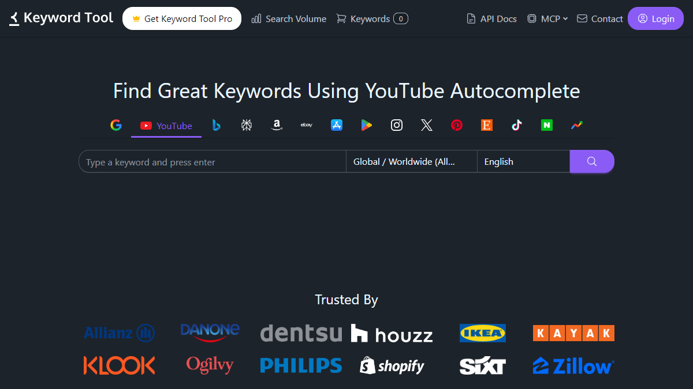

<figcaption style="font-size: 0.85rem; color: #64748b; margin-top: 0.5rem; text-align: center;">KeywordTool.io YouTube results, with volume columns locked in the free version.</figcaption>
</figure>

**Best for:** Researchers who need the highest raw keyword count per search.

KeywordTool.io pulls from YouTube autocomplete and returns 750+ keyword suggestions per search in its free version, which needs no account (keywordtool.io, 2026). It splits results into keywords, questions, prepositions, and hashtags.

Search volume sits on the paid plans. Keyword Tool Pro starts at $88/month on the Starter plan, or $68/month billed annually (keywordtool.io/pro, 2026). The free version gives you quantity with no way to rank it.

**Key advantage:** More raw keywords per search than most tools on this list.

**Key limitation:** Volume data starts at $68/month. The free version shows the suggestions and keeps the numbers behind the upgrade.

**Pricing:** Free version without volume data. Starter $88/month, or $68/month billed annually; Growth, Scale, and Agency plans cost more (keywordtool.io/pro, 2026).

**Reviews:** 4.3/5 on [Capterra](https://www.capterra.com/p/179574/Keyword-Tool/reviews/) from 36 reviews (Capterra, 2026).

**Verdict:** Strong for raw keyword discovery. Expensive if you need the data that makes those keywords actionable.

**Try it:** [KeywordTool.io YouTube](https://keywordtool.io/youtube)

### 3. Pemavor Autocomplete Tool

<figure style="margin: 1.5rem 0;">

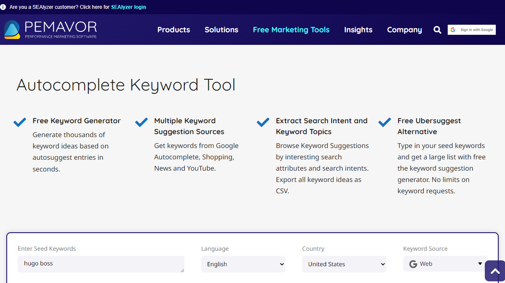

<figcaption style="font-size: 0.85rem; color: #64748b; margin-top: 0.5rem; text-align: center;">Pemavor autocomplete results for a YouTube seed keyword.</figcaption>
</figure>

**Best for:** SEO professionals who need bulk autocomplete data across YouTube and Google with zero friction.

Pemavor covers four autocomplete sources: Google Search, Google Shopping, Google News, and YouTube. Its page says you do not need to register and that there are no limits on keyword requests (pemavor.com, 2026). It exports to CSV, lets you browse suggestions by search attributes and intents, and shows n-gram topics that surface recurring words across your results (pemavor.com, 2026).

**Key advantage:** Unlimited free searches with no signup across four sources.

**Key limitation:** No volume or CPC data, and no buyer-intent priority per keyword.

**Pricing:** Free, with no signup.

**Reviews:** No third-party rating listing found for this free tool, which is expected for a no-signup utility.

**Verdict:** The best free bulk autocomplete tool if you already have a separate way to evaluate keywords.

**Try it:** [Pemavor Autocomplete Tool](https://www.pemavor.com/solution/autocomplete-keyword-tool/)

### 4. Keyword Tool Dominator

<figure style="margin: 1.5rem 0;">

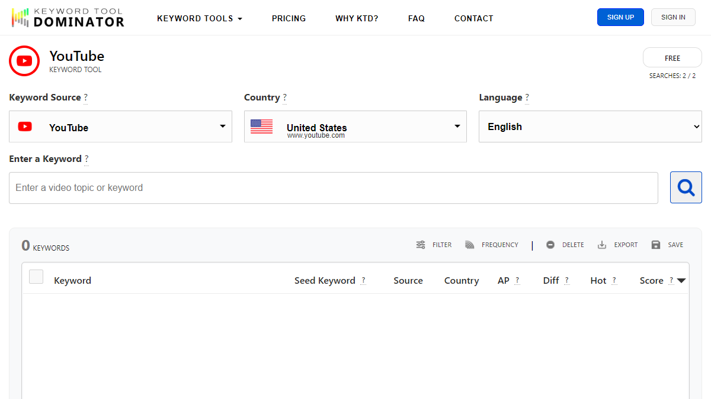

<figcaption style="font-size: 0.85rem; color: #64748b; margin-top: 0.5rem; text-align: center;">Keyword Tool Dominator YouTube results with the Popularity Score column.</figcaption>
</figure>

**Best for:** Creators who want scored autocomplete data without paying for a full SEO suite.

Keyword Tool Dominator adds a Popularity Score (0-100) to each autocomplete suggestion. The score compares phrases inside your current results; it is not a search volume figure. The tool also flags rising terms as "hot" and pulls live YouTube autocomplete from 50+ countries. Its AI Intents tool, included on every plan, builds scored keyword lists from one seed (keywordtooldominator.com, 2026).

The free version allows 2 searches per day per keyword source, with no signup. Paid access is a one-time payment for a fixed period, not a subscription.

For 30 days, Plus costs $9 for one tool, Pro costs $15 for five tools, and Max costs $25 for all 8 tools. Longer access costs more: 1 year starts at $39, and Max lifetime access is $149 (keywordtooldominator.com/pricing, 2026).

**Key advantage:** The Popularity Score adds a ranking layer that most free tools lack.

**Key limitation:** The free tier is too small for serious research, and the score only ranks phrases against each other, not against real search volume.

**Pricing:** Free tier with 2 searches per day per keyword source. One-time paid access from $9 (Plus, 30 days), 1 year from $39, Max lifetime $149 (keywordtooldominator.com/pricing, 2026).

**Reviews:** No third-party rating listing found, which is typical for a niche autocomplete utility. We report the absence rather than invent a number.

**Verdict:** Good one-time value if you need scored autocomplete data for a project without a monthly bill.

**Try it:** [Keyword Tool Dominator](https://www.keywordtooldominator.com/youtube-keyword-tool)

### 5. Keyword.io

<figure style="margin: 1.5rem 0;">

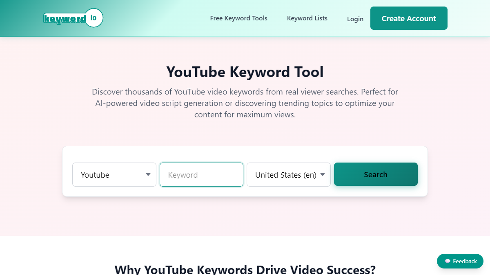

<figcaption style="font-size: 0.85rem; color: #64748b; margin-top: 0.5rem; text-align: center;">Keyword.io YouTube Longtail Finder results.</figcaption>
</figure>

**Best for:** Marketers building large keyword lists across multiple search sessions.

Keyword.io's YouTube Longtail Finder runs a to z expansion on your seed keyword and returns hundreds of autocomplete suggestions. Searching is free without an account. Its list feature lets you save keywords from one search, run another, and keep adding; saving lists needs a free account ("Sign up to save and organize your keywords," keyword.io, 2026).

**Key advantage:** Saved lists let you compile keywords across many sessions.

**Key limitation:** No volume, CPC, or intent data, and the tool page does not say whether lists export to CSV.

**Pricing:** Free. Searching needs no account; saved lists need a free account.

**Reviews:** No third-party rating listing found for this free tool.

**Verdict:** Good for free, multi-session keyword collection if you are fine creating an account.

**Try it:** [Keyword.io YouTube Longtail Finder](https://www.keyword.io/tool/youtube-longtail-finder)

### 6. RyRob YouTube Keyword Tool

<figure style="margin: 1.5rem 0;">

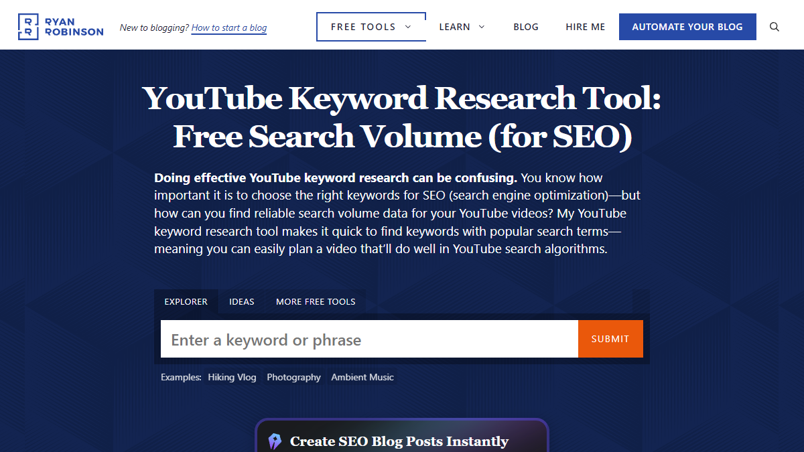

<figcaption style="font-size: 0.85rem; color: #64748b; margin-top: 0.5rem; text-align: center;">RyRob YouTube keyword results with estimated search volume.</figcaption>
</figure>

**Best for:** Solo creators who want YouTube search volume estimates for free.

RyRob, the free YouTube keyword tool built by blogger Ryan Robinson (ryrob.com), returns keyword suggestions with estimated monthly YouTube searches, mainly from the US, and a low, medium, or high difficulty level. Free volume data is rare. No signup, no credit card.

**Key advantage:** Free YouTube search volume data, so you can check demand without paying for a full SEO suite.

**Key limitation:** Volume estimates mainly reflect US searches. Limited filtering options.

**Pricing:** Free. No signup or credit card required.

**Reviews:** No third-party rating listing found. It is a free tool on Ryan Robinson's blog rather than a listed product, so the absence is expected.

**Verdict:** The best free option when volume data matters more than autocomplete breadth.

**Try it:** [RyRob YouTube Keyword Tool](https://www.ryrob.com/youtube-keyword-tool/)

### 7. YouAutoCompleteMe

<figure style="margin: 1.5rem 0;">

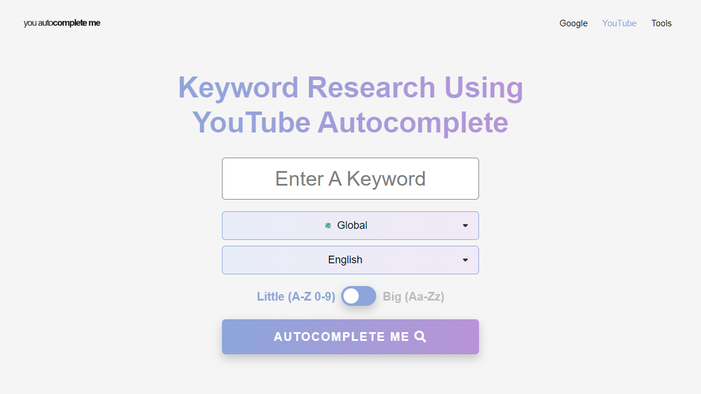

<figcaption style="font-size: 0.85rem; color: #64748b; margin-top: 0.5rem; text-align: center;">YouAutoCompleteMe suggestions for a YouTube seed keyword.</figcaption>
</figure>

**Best for:** Quick keyword brainstorming with zero commitment.

YouAutoCompleteMe pulls autocomplete suggestions from YouTube. No account. No install. Type a keyword, see suggestions.

**Key advantage:** YouAutoCompleteMe is the simplest tool on this list: type a keyword and the suggestions appear at once.

**Key limitation:** Rate limiting: the page allows "15-20 Little OR 1-2 Big" searches before a timeout and suggests a 30-minute break (youautocompleteme.io, 2026). The page shows a Download button but does not say what it exports. No extra data of any kind.

**Pricing:** Free. No account or install.

**Reviews:** No third-party rating listing found for this free tool. It is a single-purpose utility, so the absence is expected.

**Verdict:** Fine for a quick spot check. Too limited for systematic keyword research.

**Try it:** [YouAutoCompleteMe](https://youautocompleteme.io/youtube/)

### 8. Ahrefs YouTube Keyword Tool

<figure style="margin: 1.5rem 0;">

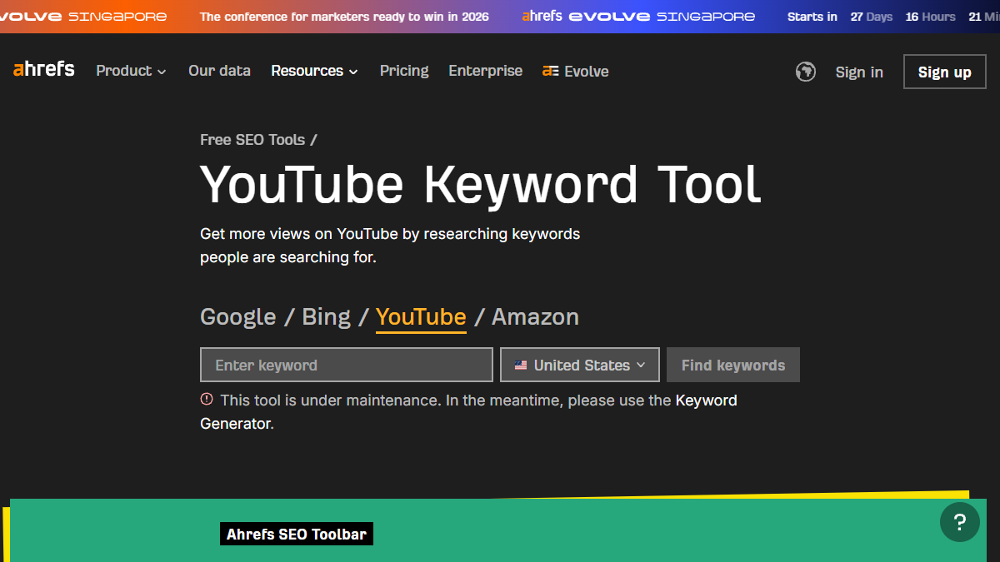

<figcaption style="font-size: 0.85rem; color: #64748b; margin-top: 0.5rem; text-align: center;">Ahrefs YouTube Keyword Tool page.</figcaption>
</figure>

**Best for:** SEO professionals already in the Ahrefs ecosystem.

Ahrefs offers a free YouTube keyword generator with search volume estimates for 170 countries. Its paid Keywords Explorer adds keyword difficulty and deeper keyword data.

**Key advantage:** Volume estimates for 170 countries from a major SEO platform, once the tool is back online.

**Key limitation:** The YouTube keyword tool page shows "This tool is under maintenance." instead of results (ahrefs.com, 2026), so it is not usable right now, though it has not been discontinued. The broader free tier is deliberately limited.

**Pricing:** Free YouTube keyword generator (currently under maintenance). Paid Ahrefs plans start at $29/month (Starter), with Lite at $129/month, Standard at $249/month, and Advanced at $449/month (ahrefs.com/pricing, 2026).

**Reviews:** 4.7/5 on [Capterra](https://www.capterra.com/p/176340/Ahrefs/) from 580+ reviews (Capterra, 2026).

**Verdict:** Worth checking once it comes back online. Not usable for autocomplete research while the maintenance notice is up.

**Try it:** [Ahrefs YouTube Keyword Tool](https://ahrefs.com/youtube-keyword-tool)

### 9. SemanticPen

<figure style="margin: 1.5rem 0;">

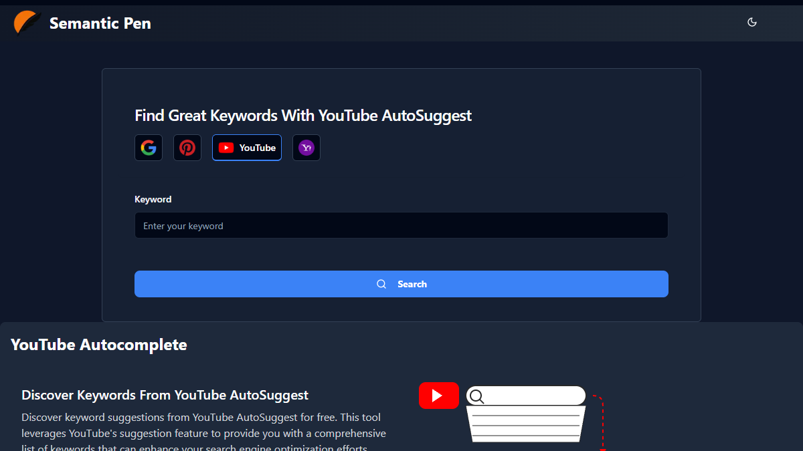

<figcaption style="font-size: 0.85rem; color: #64748b; margin-top: 0.5rem; text-align: center;">SemanticPen YouTube autocomplete suggestion tool.</figcaption>
</figure>

**Best for:** Content teams already using SemanticPen's AI writing platform.

SemanticPen includes a YouTube autocomplete suggestion tool as part of its content suite. Copy-all and CSV export are supported, and new accounts get free credits with no card.

**Key advantage:** Sits inside a broader content workflow with AI writing features.

**Key limitation:** Requires an account and runs on credits. Not practical as a standalone autocomplete tool.

**Pricing:** Free credits at signup, then SemanticPen's credit-based content plans rather than a standalone autocomplete price.

**Reviews:** No third-party rating listing found for the autocomplete tool specifically. We report the absence rather than attribute a rating from the broader platform.

**Verdict:** Useful if you already pay for SemanticPen. Skip otherwise.

**Try it:** [SemanticPen YouTube Autocomplete](https://www.semanticpen.com/tools/youtube-autocomplete-suggestion)

### 10. Botster YouTube Keyword Scraper

<figure style="margin: 1.5rem 0;">

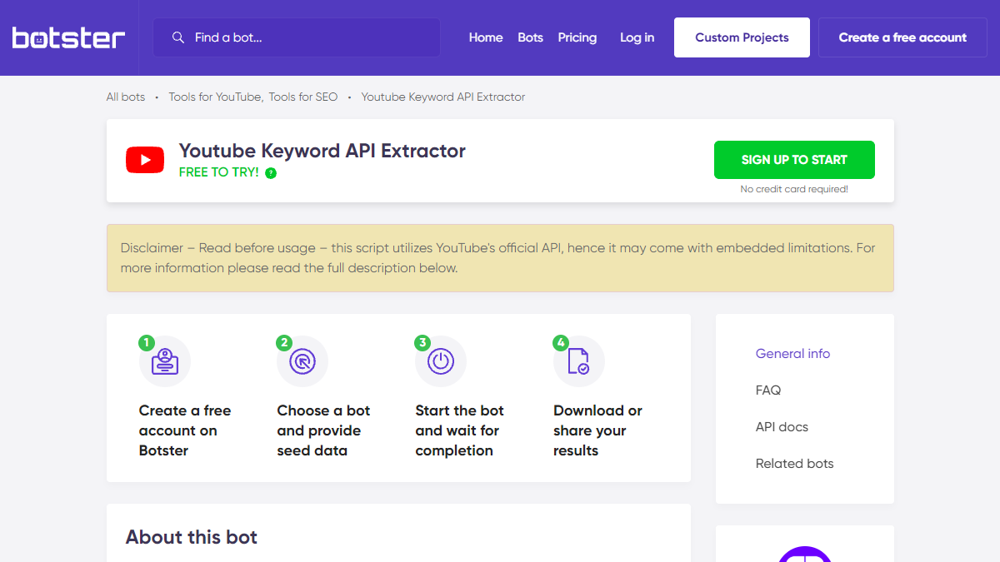

<figcaption style="font-size: 0.85rem; color: #64748b; margin-top: 0.5rem; text-align: center;">Botster YouTube Keyword Suggestions Scraper settings.</figcaption>
</figure>

**Best for:** Agencies and technical teams who need deep autocomplete scraping at scale.

Botster runs a configurable bot that scrapes YouTube autocomplete at three depth levels. Depth 1 gets direct suggestions. Depth 2 appends whitespace and scrapes again. Depth 3 goes one layer deeper, so one run returns far more suggestions than a single pass.

**Key advantage:** Goes deeper than any browser-based tool on this list.

**Key limitation:** Requires an account and paid credits. Not instant: you configure a bot, start it, and wait.

**Pricing:** Pay-as-you-go credits from $25 at $1.00 per 1,000 credits, or monthly plans from $25. New users get a one-time offer of 3,000 credits for $3 (botster.io/pricing, 2026).

**Reviews:** No third-party rating listing found for this specific scraper bot. We report the absence rather than invent one.

**Verdict:** Overkill for solo keyword research. Powerful for agencies processing autocomplete data at scale.

**Try it:** [Botster YouTube Keyword Scraper](https://botster.io/bots/youtube-keyword-suggestions-scraper)

### 11. Apify YouTube Autocomplete Scrapers

<figure style="margin: 1.5rem 0;">

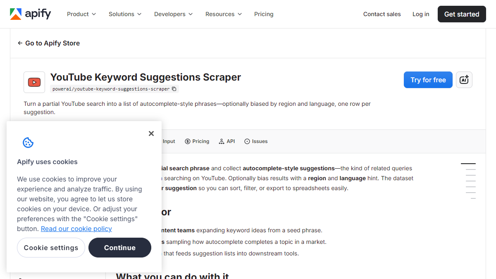

<figcaption style="font-size: 0.85rem; color: #64748b; margin-top: 0.5rem; text-align: center;">Apify YouTube autocomplete actor input settings.</figcaption>
</figure>

**Best for:** Developers building automated keyword pipelines.

Apify hosts several YouTube autocomplete actors from different developers. The one linked below, by PowerAI, takes a seed query plus optional region and language inputs and returns one dataset row per suggestion, with its position and a timestamp, which you read through Apify's API.

**Key advantage:** Full programmatic access for automated, repeatable scraping.

**Key limitation:** Requires an Apify account, an API token, and developer knowledge.

**Pricing:** Pay per result, from $3.99 per 1,000 results for the PowerAI actor (apify.com, 2026), plus an Apify account.

**Reviews:** The PowerAI actor's Apify page shows "No ratings yet" (apify.com, 2026). We do not borrow a rating from the broader Apify platform.

**Verdict:** The right choice if autocomplete data needs to flow into an automated pipeline. Not a marketing tool.

**Try it:** [Apify YouTube Autocomplete Scrapers](https://apify.com/powerai/youtube-keyword-suggestions-scraper)

## How to Find Great Keywords Using YouTube Autocomplete

Finding keywords is easy. Finding keywords that attract buyers is the hard part. Here is a five-step process that turns YouTube autocomplete into a reliable keyword pipeline for your business channel.

**Step 1: Start with your buyer's problem, not your product.**

Type what your customer would search before they know your product exists. A CRM company should not start with "best CRM." Start with "how to track client conversations" or "sales follow up system." These seed keywords reveal long-tail phrases your competitors miss because they only search for their own brand terms.

**Step 2: Run the alphabet soup expansion.**

Enter your seed keyword followed by each letter of the alphabet. "Sales follow up a" returns "sales follow up app," "sales follow up automation," and "sales follow up after meeting." Do this manually or use an [autocomplete keyword tool](/tools/youtube-autocomplete-keywords) to run all 26 variations at once. In our experience the manual version takes 20-30 minutes per keyword. For the full manual technique step by step, see our guide on [how to find YouTube autocomplete keywords](/blog/how-to-find-youtube-autocomplete-keywords).

**Step 3: Add buyer-intent modifiers.**

Append intent-signaling words to your seed: "best," "vs," "pricing," "review," "mistakes," "for small business." These modifiers surface keywords from people closer to a purchase decision. "Sales follow up software pricing" attracts a very different viewer than "what is sales follow up." Focus your modifier list on words that signal evaluation and comparison, not general curiosity.

**Step 4: Tag each keyword by intent.**

Sort your list into three buckets. High intent: comparisons, pricing, mistakes, and reviews. Medium intent: how-to guides and tutorials. Low intent: definitions and general research. Target High-intent keywords first if you want leads this quarter, and Low-intent keywords for long-term search authority. In our experience, a business channel should put most of its effort into High-intent topics. SellonTube's autocomplete tool does this tagging automatically.

**Step 5: Validate against YouTube search results.**

Before committing to a keyword, search for it on YouTube. If the top results are from channels with millions of subscribers, that keyword may be too competitive for a new channel. If the top results are low-quality, outdated, or poorly optimized, you have an opening.

Google Trends' YouTube Search filter shows whether interest in the phrase is rising or fading. Run your shortlist through our [keyword finder tool](/tools/youtube-video-keyword-finder) to check ranking difficulty before you commit a full video to it. For a deeper validation process, see the [YouTube keyword research guide](/blog/youtube-keyword-research).

With the right tool, the whole process from seed keyword to prioritized content plan fits in an afternoon. Without one, expect a full day and a messier list.

## How to Choose the Right YouTube Autocomplete Tool

The right YouTube autocomplete tool depends on three things: your budget, your technical comfort, and what you plan to do with the keywords. If you are still deciding whether YouTube is the right channel, read the [YouTube marketing ROI guide](/blog/youtube-marketing-roi) first. Answer these four questions in order.

**1. Do you need to know which keywords attract buyers?**

- **If yes →** SellonTube. It tags every keyword with a buyer-intent priority and groups the full list into video topics; the full list costs an email address.
- **If no, you only need raw suggestions →** Pemavor (unlimited, CSV, no account) or Keyword.io (free account for saved lists).

**2. Do you need search volume numbers?**

- **If yes, and free →** RyRob, the only currently working free tool here with YouTube-specific volume estimates.
- **If yes, and you will pay monthly →** KeywordTool.io, from $68/month billed annually or $88/month monthly (keywordtool.io/pro, 2026), for 750+ suggestions with volume.
- **If you want a score without a subscription →** Keyword Tool Dominator, one-time access from $9 for 30 days or from $39 for a year (keywordtooldominator.com/pricing, 2026).

**3. Are you only spot-checking a phrase or two?**

- **If yes →** YouAutoCompleteMe. It works instantly, but it times out after 15-20 small searches.

**4. Do you have developer resources and need data at scale?**

- **If yes →** Botster for deep multi-level scraping, or Apify for a pipeline you call through an API.
- **If no →** skip both, and skip Ahrefs' YouTube tool until its maintenance notice comes down.

> **Read more:** [Best YouTube SEO Tools for Business Owners](/blog/best-youtube-seo-tools-for-business)

## Why Aren't vidIQ and TubeBuddy on This List?

vidIQ and TubeBuddy are left out because they are channel-growth suites with keyword research inside, not autocomplete tools. The same goes for Semrush and for SEO PowerSuite's Rank Tracker, a desktop app with a YouTube autocomplete module. Each bundles autocomplete with volume, rank tracking, or channel analytics, so judging them on autocomplete alone would undersell them.

If you already pay for one, check its keyword module before adding another tool.

## What the Free Tools Save You vs the Paid Ones

The free tools cover the core job of keyword discovery for $0. Pemavor, RyRob, and YouAutoCompleteMe are free with no account, Keyword.io is free with a free account for saved lists, and SellonTube is free in exchange for an email address. Here is what the paid options cost per year next to them, with the math shown.

- **Free autocomplete vs a monthly volume subscription.** KeywordTool.io Starter is $88/month, so $88 × 12 = $1,056/year, or $68 × 12 = $816/year on annual billing (keywordtool.io/pro, 2026). For a channel that mainly needs to discover and prioritize keywords, that is $816 to $1,056 a year for volume data you can approximate for free with RyRob.
- **One-time payment vs recurring subscription.** Keyword Tool Dominator sells one-time access instead of a monthly bill, with 1 year from $39 (keywordtooldominator.com/pricing, 2026). $39 against $816 a year is about 95% less than KeywordTool.io on annual billing, roughly $777 saved in the first year, and it still adds a Popularity Score the free tools lack.
- **Intent tagging is on a free tool, not a paid one.** Buyer-intent priority, the feature most directly tied to customer acquisition, is on SellonTube's free tool. None of the paid vendor pages above describe a High, Medium, or Low buyer-intent priority per keyword, so paying more does not buy you that step.

The honest bottom line on cost

For keyword discovery and buyer-intent prioritization, a free tool does the job. Pay for KeywordTool.io only when you genuinely need monthly volume estimates at scale ($816 to $1,056 a year on the Starter plan). Keyword Tool Dominator's one-time access, from $39 for a year, is the cheaper way to add a scoring layer.

## Which Autocomplete Tool for Your Situation: A Cheat Sheet

The cheat sheet below matches 12 common situations to the autocomplete tool we would pick, with the reason in one line.

<table style="width: 100%; border-collapse: collapse; font-size: 0.95rem; min-width: 700px;">
<thead>
<tr style="background: #f8fafc; border-bottom: 2px solid #e2e8f0;">
<th style="padding: 0.75rem 1rem; text-align: left; font-weight: 700; color: #1e293b;">Your scenario</th>
<th style="padding: 0.75rem 1rem; text-align: left; font-weight: 700; color: #1e293b;">Best choice</th>
<th style="padding: 0.75rem 1rem; text-align: left; font-weight: 700; color: #1e293b;">Why</th>
</tr>
</thead>
<tbody>
<tr style="border-bottom: 1px solid #e2e8f0; background: #f0fdf4;">
<td style="padding: 0.75rem 1rem; color: #334155;">Best free tool for buyer-intent keywords</td>
<td style="padding: 0.75rem 1rem; font-weight: 600; color: #166534;">SellonTube (our tool)</td>
<td style="padding: 0.75rem 1rem; color: #334155;">Free preview with no signup; the full intent-tagged list, video-topic clusters, and CSV cost an email address</td>
</tr>
<tr style="border-bottom: 1px solid #e2e8f0; background: #f0fdf4;">
<td style="padding: 0.75rem 1rem; color: #334155;">Intent-tagged keywords / which keywords attract buyers</td>
<td style="padding: 0.75rem 1rem; font-weight: 600; color: #166534;">SellonTube (our tool)</td>
<td style="padding: 0.75rem 1rem; color: #334155;">The only tool here whose page describes a High/Medium/Low buyer-intent priority per keyword</td>
</tr>
<tr style="border-bottom: 1px solid #e2e8f0;">
<td style="padding: 0.75rem 1rem; color: #334155;">Quick check with no account</td>
<td style="padding: 0.75rem 1rem; font-weight: 600; color: #1e293b;">YouAutoCompleteMe or Pemavor</td>
<td style="padding: 0.75rem 1rem; color: #334155;">Both return suggestions instantly with no account; Pemavor adds CSV export and has no request limit</td>
</tr>
<tr style="border-bottom: 1px solid #e2e8f0;">
<td style="padding: 0.75rem 1rem; color: #334155;">Multi-platform autocomplete (YouTube + Google)</td>
<td style="padding: 0.75rem 1rem; font-weight: 600; color: #1e293b;">Pemavor</td>
<td style="padding: 0.75rem 1rem; color: #334155;">Covers Google Search, Shopping, News, and YouTube in one free tool</td>
</tr>
<tr style="border-bottom: 1px solid #e2e8f0;">
<td style="padding: 0.75rem 1rem; color: #334155;">Free YouTube search volume estimates</td>
<td style="padding: 0.75rem 1rem; font-weight: 600; color: #1e293b;">RyRob</td>
<td style="padding: 0.75rem 1rem; color: #334155;">The only currently working free tool here that adds YouTube-specific volume and difficulty data</td>
</tr>
<tr style="border-bottom: 1px solid #e2e8f0;">
<td style="padding: 0.75rem 1rem; color: #334155;">Highest raw keyword count per search</td>
<td style="padding: 0.75rem 1rem; font-weight: 600; color: #1e293b;">KeywordTool.io</td>
<td style="padding: 0.75rem 1rem; color: #334155;">Returns 750+ suggestions, though volume data sits on the paid plans</td>
</tr>
<tr style="border-bottom: 1px solid #e2e8f0;">
<td style="padding: 0.75rem 1rem; color: #334155;">Build a list across multiple sessions</td>
<td style="padding: 0.75rem 1rem; font-weight: 600; color: #1e293b;">Keyword.io</td>
<td style="padding: 0.75rem 1rem; color: #334155;">Saved lists collect picks across searches, with a free account</td>
</tr>
<tr style="border-bottom: 1px solid #e2e8f0;">
<td style="padding: 0.75rem 1rem; color: #334155;">A popularity score without a full SEO suite</td>
<td style="padding: 0.75rem 1rem; font-weight: 600; color: #1e293b;">Keyword Tool Dominator</td>
<td style="padding: 0.75rem 1rem; color: #334155;">Adds a 0-100 Popularity Score with one-time access from $9, not a subscription</td>
</tr>
<tr style="border-bottom: 1px solid #e2e8f0;">
<td style="padding: 0.75rem 1rem; color: #334155;">Export results to CSV</td>
<td style="padding: 0.75rem 1rem; font-weight: 600; color: #1e293b;">Pemavor or SellonTube</td>
<td style="padding: 0.75rem 1rem; color: #334155;">Pemavor exports raw suggestions with no account; SellonTube's CSV carries intent, value, and video-topic columns after you enter an email</td>
</tr>
<tr style="border-bottom: 1px solid #e2e8f0;">
<td style="padding: 0.75rem 1rem; color: #334155;">Bulk scraping at depth for an agency</td>
<td style="padding: 0.75rem 1rem; font-weight: 600; color: #1e293b;">Botster</td>
<td style="padding: 0.75rem 1rem; color: #334155;">A three-level bot that goes deeper than browser tools, paid in credits</td>
</tr>
<tr style="border-bottom: 1px solid #e2e8f0;">
<td style="padding: 0.75rem 1rem; color: #334155;">Developer building an automated pipeline</td>
<td style="padding: 0.75rem 1rem; font-weight: 600; color: #1e293b;">Apify</td>
<td style="padding: 0.75rem 1rem; color: #334155;">Pay-per-result actors you call through Apify's API, with region and language inputs</td>
</tr>
<tr>
<td style="padding: 0.75rem 1rem; color: #334155;">Target a specific country or market</td>
<td style="padding: 0.75rem 1rem; font-weight: 600; color: #1e293b;">SellonTube or Keyword Tool Dominator</td>
<td style="padding: 0.75rem 1rem; color: #334155;">SellonTube offers 19 countries plus Global; Keyword Tool Dominator pulls autocomplete from 50+ countries</td>
</tr>
</tbody>
</table>

## What to Do This Week

1. Open the [SellonTube YouTube Autocomplete Keyword Tool](/tools/youtube-autocomplete-keywords) and enter your most important product keyword.
2. Run the quick scrape and read the Comparison & Evaluation preview first. Those keywords are closest to a buying decision.
3. Enter your email to run the full scrape. The tool groups the keywords into video topics and downloads the CSV; sort it by the value column.
4. Pick three high-value topics. Each primary keyword becomes a video title. Use the [YouTube Title Generator](/tools/youtube-title-generator) to create click-worthy variations.
5. Run your existing videos through the [YouTube SEO Tool](/tools/youtube-seo-tool) to check if your metadata matches the phrases buyers actually search.
6. Set a calendar reminder to re-run the scrape quarterly. YouTube autocomplete changes as search behavior shifts.

## FAQ

**Free and best-pick options**

### What is the best free YouTube autocomplete keyword tool for my business channel?

For a business channel, the SellonTube YouTube Autocomplete Keyword Tool (our tool) is the pick when you want keywords sorted by buyer intent. The quick scrape is free with no signup and previews up to 3 keywords per intent category; the full list, AI video-topic clusters, and the CSV cost an email address. If you want everything free with no account, [Pemavor](https://www.pemavor.com/solution/autocomplete-keyword-tool/) gives unlimited raw suggestions with CSV export, and RyRob adds free YouTube volume estimates.

### Is there a free YouTube autocomplete keyword generator I can use without signing up?

Yes. Pemavor, RyRob, and YouAutoCompleteMe all run without an account. Keyword.io searches without an account too, but saving lists needs one. Keyword Tool Dominator allows 2 free searches per day per keyword source with no signup. SellonTube's quick scrape needs no signup but shows a preview; the full list needs an email address.

### What tools should I use to find YouTube autocomplete keywords?

Match the tool to the job. SellonTube (our tool) sorts suggestions into five intent categories with a High, Medium, or Low priority and groups the full list into video topics. Pemavor is the free pick for raw bulk suggestions with CSV export. RyRob adds free YouTube volume estimates. KeywordTool.io returns 750+ suggestions per search in its free version, with volume data on its paid plans. Once you have a list, [check what keywords your videos already rank for](/blog/how-to-find-youtube-video-ranking-keywords) before you pick new topics.

### Are there free YouTube keyword research tools that actually work?

Yes. Pemavor (unlimited searches, CSV export), RyRob (volume estimates), and YouAutoCompleteMe (quick checks, rate limited) are free with no account. Keyword.io is free to search, with a free account for saved lists. KeywordTool.io and Keyword Tool Dominator have free tiers with limits, and SellonTube's free preview becomes the full list in exchange for an email address. Botster and Apify are paid.

**Search intent**

### Is there a YouTube keyword tool that tells me which keywords have buyer intent?

Yes. The SellonTube YouTube Autocomplete Keyword Tool (our tool) sorts suggestions into Comparison, Mistakes, Results, How-To, and Research categories and gives each a High, Medium, or Low priority. Of the vendor pages for the 11 tools on this list, it is the only one that describes a buyer-intent priority per keyword. Pemavor lets you browse suggestions by search attributes and intents, and Keyword Tool Dominator sells an AI Intents tool, but neither page describes a buyer priority.

**Accuracy and data**

### How accurate are YouTube autocomplete keyword tools compared to volume-based tools?

Autocomplete tools that query YouTube's suggestion endpoint (SellonTube, Pemavor, YouAutoCompleteMe) return the exact phrases YouTube shows searchers. They tell you a phrase is being searched, not how often. Volume tools such as RyRob and Ahrefs estimate monthly searches, and in our experience those estimates are rough for niche B2B queries. Use autocomplete for discovery, then volume data to rank the top candidates. For a deeper breakdown of keyword strategy, see the [YouTube SEO guide](/blog/youtube-seo-guide).

**Manual research and freshness**

### Can I do YouTube keyword research with just the search bar, without a tool?

Yes. Open YouTube, type your seed keyword, and write down the suggestions. Then add a space and each letter from a to z and note the new suggestions. It works, but in our experience it takes 20-30 minutes per keyword, gives you nothing to export, and does not separate buyer queries from informational ones. An autocomplete tool runs the same queries in one go.

### How often does YouTube update its autocomplete suggestions?

YouTube changes autocomplete suggestions as search behavior changes, so a phrase that did not appear last month can appear today. Autocomplete data goes stale. Re-run your seed keywords quarterly, or monthly if you publish weekly.

**Languages, markets, and Keyword Planner**

### Do YouTube autocomplete keyword tools work for my country or language?

Some do. SellonTube offers 19 countries plus a Global setting. Keyword Tool Dominator pulls live YouTube autocomplete from 50+ countries. RyRob's volume estimates mainly reflect US searches. If you sell to one country, set the geography before scraping, because a global run mixes suggestions from every market.

### What is the difference between YouTube autocomplete keywords and Google Keyword Planner data?

YouTube autocomplete keywords are the exact phrases YouTube suggests as a user types. Google Keyword Planner estimates monthly volume from Google Search, not YouTube, and shows wide ranges such as 100-1K. A phrase with no Keyword Planner volume can still appear in YouTube autocomplete because people search it on YouTube. For YouTube content planning, autocomplete is the more direct demand signal. To turn keyword insights into a full plan, see [YouTube Marketing Strategy for B2B](/blog/youtube-marketing-strategy).

---

**Related tool guides:** Once you have your keyword list, see which of your videos already rank with our roundup of the [best YouTube rank checker tools for business](/blog/best-youtube-rank-checker-tools-for-business), and turn winning keywords into topics with the [best YouTube video ideas generators for businesses](/blog/best-youtube-video-ideas-generators-for-businesses). To hear which of those phrases competitors actually say on camera, pick a tool from our [comparison of free and paid YouTube transcript tools](/blog/best-youtube-transcript-generators). Or start with the free preview in the [SellonTube YouTube Autocomplete Keyword Tool](/tools/youtube-autocomplete-keywords) and see your keywords sorted by buyer intent.
