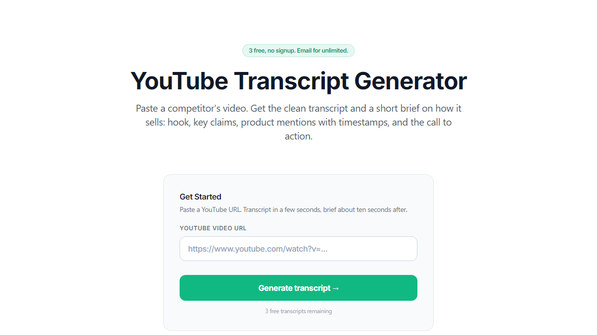
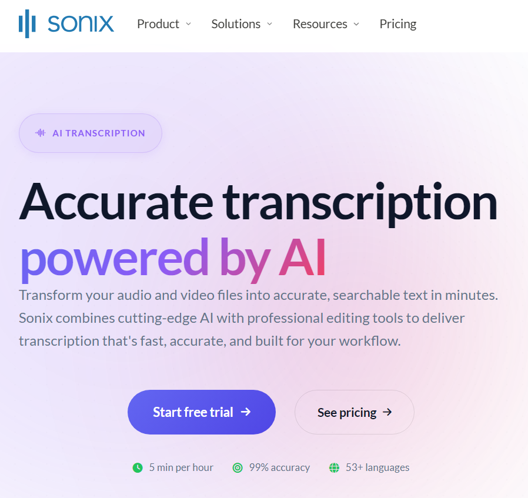
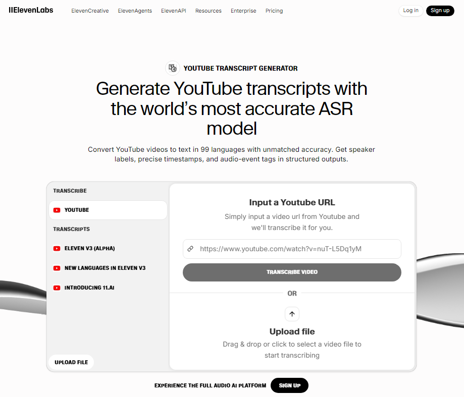
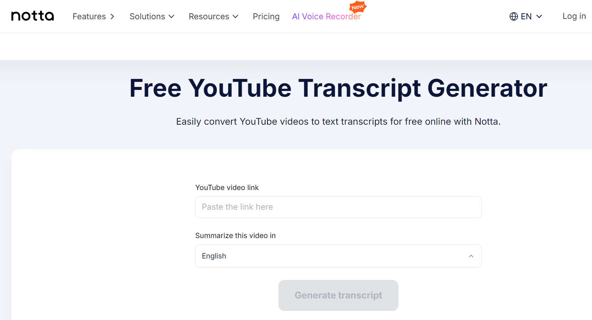
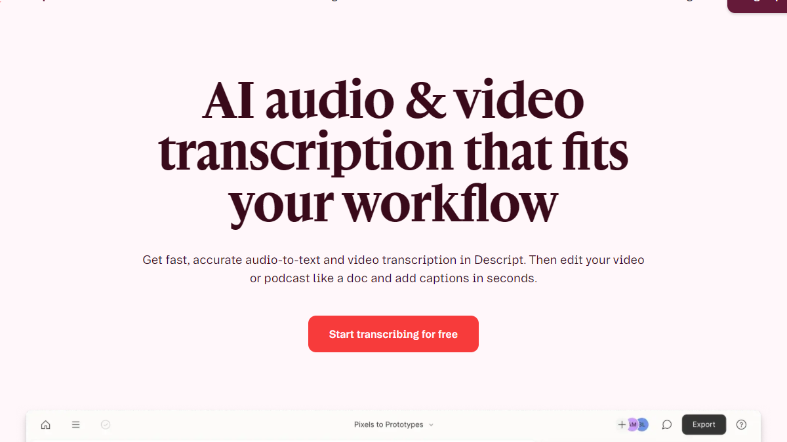
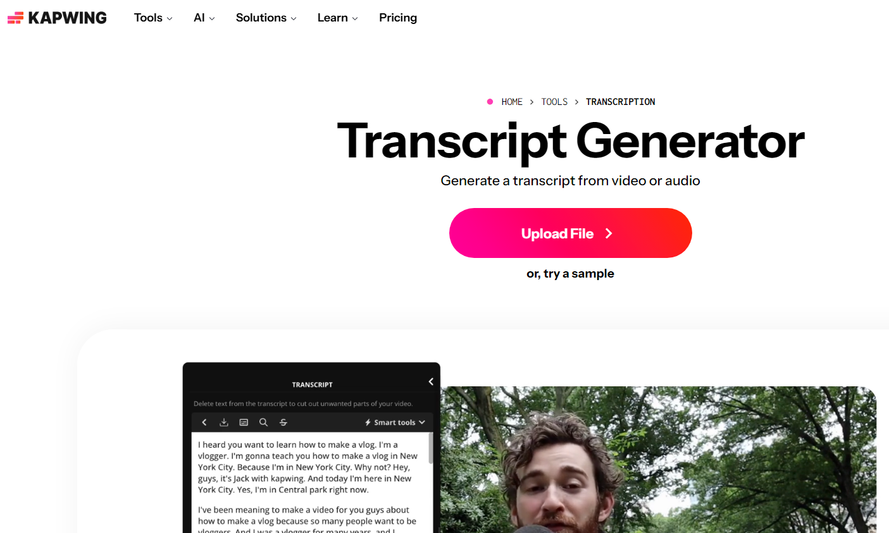
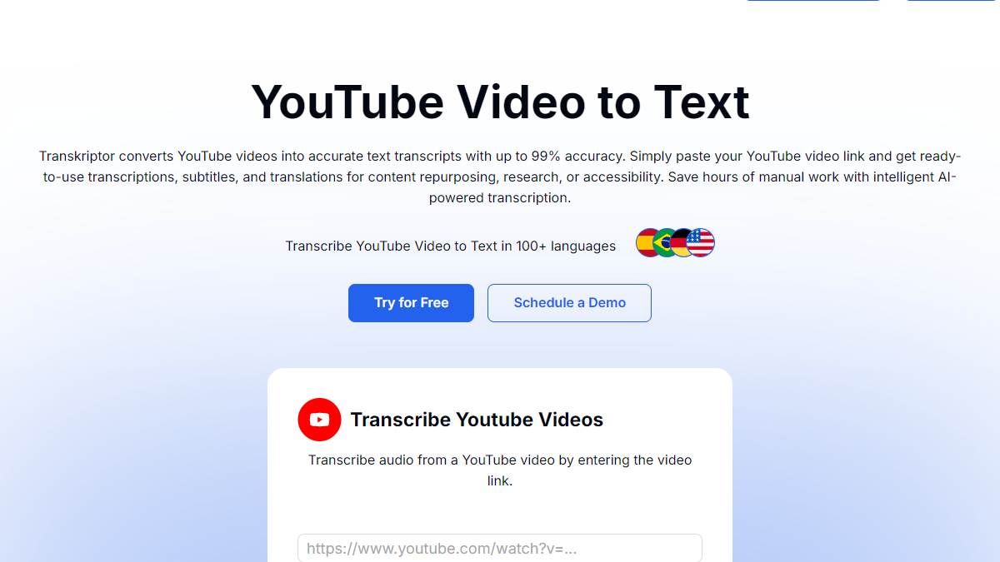
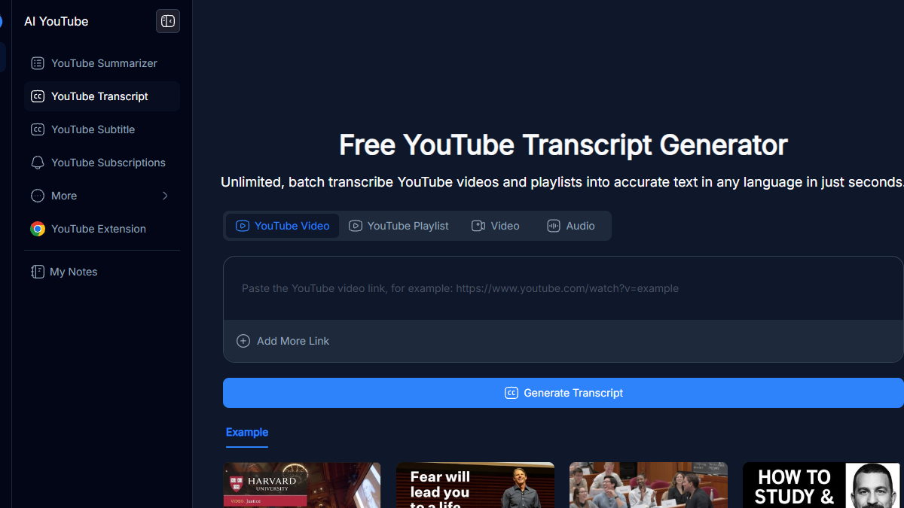
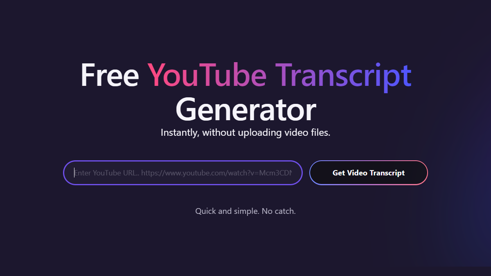

import YouTubeFacade from '~/components/widgets/YouTubeFacade.astro';

Almost every YouTube transcript tool list is written for creators captioning their own videos or journalists transcribing interviews. The tools are ranked on caption accuracy and subtitle export formats.

Business teams use transcripts for something else.

For B2B marketers, SEO managers, GTM teams and content operators, a transcript generator does a different job. You convert competitor videos into searchable text and pull keyword patterns from high-performing content. You also repurpose your own video archive into written assets and feed transcripts into research or AI workflows.

This list ranks 9 YouTube transcript generators for that job. We make SellonTube's transcript generator, and it is listed first because it was built for competitor research. Free limits, signup rules, export formats and prices for the other eight come from each vendor's own pricing or tool page.

SellonTube's YouTube Transcript Generator (our tool) is the best free YouTube transcript generator for business teams studying competitor videos, because it returns the transcript plus a competitor-research brief: the video's hook, key claims, timestamped sections, product mentions and call to action. You get 3 free transcripts, then a free email gives you more. It reads the captions YouTube already has, so a video without captions returns nothing. Sonix is the best paid pick when accuracy on the audio matters: it runs its own speech-to-text, labels speakers and exports DOCX, PDF, TXT, SRT and VTT, from $10 per hour of media (Sonix pricing page, 2026). For a quick copy with no account, NoteGPT's and Tactiq's web tools both download a TXT file. Descript suits demo teardowns, and Kapwing suits teams that turn transcripts into clips. For B2B YouTube research, check first whether a tool reads captions or runs speech-to-text.

**A YouTube transcript generator is a tool that turns the speech in a YouTube video into readable, usually timestamped text, starting from the video's link.** For business teams, it turns competitor and owned video content into searchable documents you can mine for keywords, positioning and repurposing material.

<strong>Last updated:</strong> October 2026. <strong>How we evaluated:</strong> free limits, signup rules, export formats and prices come from each vendor's own pricing or tool page, and SellonTube's behaviour comes from our own tool. We cite a third-party rating only where we could re-read the listing for this update. Verify prices at each vendor's site before buying.

Key Takeaways

<ul style="margin: 0; padding-left: 1.25rem;">
<li style="margin-bottom: 0.5rem; color: #334155; font-size: 0.9rem;">SellonTube (our tool) is the top free pick for competitor research: 3 free transcripts, then a free email, and every transcript comes with a competitor-research brief.</li>
<li style="margin-bottom: 0.5rem; color: #334155; font-size: 0.9rem;">Sonix is the paid pick for speaker-labelled speech-to-text, with DOCX, PDF, TXT, SRT and VTT exports, at $10 per hour pay-as-you-go or $25 per month on Core (Sonix pricing page, 2026).</li>
<li style="margin-bottom: 0.5rem; color: #334155; font-size: 0.9rem;">ElevenLabs now has a dedicated paste-a-link YouTube page with 7 export formats, a strong free option for videos without captions.</li>
<li style="margin-bottom: 0.5rem; color: #334155; font-size: 0.9rem;">NoteGPT and Tactiq's web tools are the quickest no-account options; both let you download a TXT file.</li>
<li style="margin-bottom: 0; color: #334155; font-size: 0.9rem;">Caption-based tools fail on videos without captions; speech-to-text tools transcribe the audio but meter it by the minute.</li>
</ul>

| Tool | Best for | Key strength | Free option | Price (vendor pricing page, 2026) |
|------|----------|--------------|-------------|-------|
| SellonTube (our tool) | Competitor research | Transcript plus competitor-research brief | 3 transcripts, then a free email | Free, no paid tier |
| Sonix | Accurate transcripts of the audio | Speaker labels, 5 export formats | 30-minute trial, no card | $10/hr or Core $25/mo |
| ElevenLabs | Videos without captions | Paste a link, 7 export formats | 10,000 credits a month; commercial licence from Starter | Starter $6/mo |
| NoteGPT | Quick no-login copy | Copy or TXT download | No login on the tool page | Pro $9/mo |
| Descript | Demo teardowns | Transcript synced to video | 60 media minutes a month | Hobbyist $16/mo yearly |

## Contents

- [Why transcript tools matter for business teams](#why-transcript-tools-matter-for-business-teams)
- [How we evaluated these tools](#how-we-evaluated-these-tools)
- [At a glance](#at-a-glance)
- [The 9 YouTube transcript generators compared](#the-9-youtube-transcript-generators-compared)
  - [1. SellonTube YouTube Transcript Generator](#1-sellontube-youtube-transcript-generator)
  - [2. Sonix](#2-sonix)
  - [3. ElevenLabs YouTube Transcript Generator](#3-elevenlabs-youtube-transcript-generator)
  - [4. Notta.ai](#4-nottaai)
  - [5. Descript](#5-descript)
  - [6. Kapwing](#6-kapwing)
  - [7. Transkriptor](#7-transkriptor)
  - [8. NoteGPT](#8-notegpt)
  - [9. Tactiq](#9-tactiq)
- [Bonus: How to get a YouTube transcript directly from YouTube](#bonus-how-to-get-a-youtube-transcript-directly-from-youtube)
- [How to choose the right tool](#how-to-choose-the-right-tool)
- [Which transcript tool fits your use case?](#which-transcript-tool-fits-your-use-case)
- [FAQ](#faq)

---

## Why transcript tools matter for business teams

A clean transcript turns any YouTube video into a working document. For business teams, that means:

- Extracting competitor positioning and messaging from any public video, without re-watching it
- Pulling SEO keyword patterns from your own or competitors' best-performing content
- Repurposing video content into blog posts, social copy, email sequences, and sales enablement materials
- Building searchable research libraries across dozens of competitor channels over time
- Feeding transcripts into AI tools for pattern analysis, summarisation, gap analysis, and brief generation, as covered in our guide to [AI tools for YouTube](/blog/ai-tools-for-youtube)

Each of those jobs starts with a clean copy of the transcript.

Once you have the transcript, pair it with a [YouTube SEO analysis](/tools/youtube-seo-tool) to check whether your own videos' metadata matches what buyers search for. Competitor transcripts can also shape your own [video scripts](/tools/youtube-script-generator), modeled on these [YouTube script examples for business](/blog/youtube-script-examples-business).

<YouTubeFacade id="7cHeI6OI6vE" title="How To Get Transcript of YouTube Video - The Easiest Method (By Use Case)" caption="An independent walkthrough of getting a YouTube transcript by use case (Mike Russell). A primer before the tool-by-tool breakdown." />

## How we evaluated these tools

We evaluated each tool on six criteria, and each one answers a question a research team asks before it picks a tool.

### Caption-based or speech-to-text

**Caption-based transcript tools** pull the caption track YouTube already holds for a video. **Speech-to-text tools** run their own recognition on the video's audio.

The difference decides two things. A caption-based tool is only as accurate as YouTube's captions and fails on a video without them. A speech-to-text tool works on any audio, but it meters usage by the minute.

### YouTube URL support

A good research tool takes a public YouTube link directly. Downloading a video file first adds a step to every competitor video you study.

### Free limit and signup

The free limit decides whether a tool fits a one-off check or a weekly research habit. We list the exact cap and whether the tool asks for an account or email.

### Export formats

Export formats decide how fast the text reaches Sheets, Notion or an AI tool. A TXT download covers research; SRT and VTT matter only if you need subtitle files.

### Business features

Speaker labels, timestamps and summaries save time on competitor research. A summary that names the hook, claims and call to action saves more than a generic recap.

### Pricing transparency

Each paid price comes from the vendor's own pricing page. Where a page hides the monthly price behind a toggle, we say so instead of guessing.

## At a glance

"Not stated" means the vendor page we read does not say.

| Tool | Best for | Type | Free option | Exports | Paid from (vendor pricing page, 2026) |
|------|----------|------|-------------|---------|---------|
| SellonTube (our tool) | Competitor research briefs | Captions | 3 transcripts, then a free email | Copy, TXT | Free, no paid tier |
| Sonix | Accurate speech-to-text with speaker labels | Speech-to-text | 30-minute trial, no card | DOCX, PDF, TXT, SRT, VTT | $10/hr pay-as-you-go; Core $25/mo |
| ElevenLabs | Videos without captions | Speech-to-text | 10,000 credits a month | TXT, DOCX, PDF, SRT, VTT, JSON, HTML | Starter $6/mo |
| Notta.ai | AI summary of short clips | Not stated | 120 min a month, 3 min per file | TXT, DOCX, Excel, PDF, SRT on Pro | Pro $8.17/mo billed yearly |
| Descript | Transcript synced to video | Speech-to-text | 60 media minutes a month | Not stated | Hobbyist $16/mo yearly, $24 monthly |
| Kapwing | Transcript to clips and subtitles | Not stated | Auto-subtitles up to 10 min | TXT; SRT, VTT via Subtitles Editor | Pro $16/mo |
| Transkriptor | Plain link-to-text in 100+ languages | Speech-to-text | 90 minutes, period not stated | SRT, TXT, DOCX, PDF | Lite $9.99/mo |
| NoteGPT | Quick no-login copy | Not stated | No login; the tool page says unlimited | Copy, TXT | Pro $9/mo |
| Tactiq | Quick no-email TXT download | Speech recognition | No email needed | Copy, TXT | Pro $8/user/mo billed yearly |

## The 9 YouTube transcript generators compared

The nine tools follow the same order: what the tool is, key features, pros, cons, price, reviews and who it suits best.

### 1. [SellonTube YouTube Transcript Generator](/tools/youtube-transcript-generator)

<figure>

<figcaption>SellonTube's YouTube Transcript Generator (our tool): 3 free transcripts with no signup, then a free email unlocks more.</figcaption>
</figure>

SellonTube's YouTube Transcript Generator is our own free tool for competitor research. Paste a public YouTube link and it pulls the video's existing captions and formats them as a clean or timestamped transcript. About 10 seconds later it adds a competitor-research brief.

**Key features:**

- Clean view and timestamped view, with Copy text, Copy with timestamps and Download .txt
- Competitor-research brief: a one-line summary, the hook, 3 to 5 key claims, 5 to 8 timestamped sections, product mentions with timestamps, the call to action and the target buyer
- English captions first; if a video has no English captions, it returns the video's own caption language and labels it
- 3 free transcripts per browser, then a free email gives you more; there is no paid tier

**SellonTube pros:**

- The brief shows how a competitor video sells (hook, claims, product mentions, call to action), which no other tool on this list produces
- Free, with no paid plan to upgrade to

**SellonTube cons:**

- Caption-based: a video with captions turned off, a very new video or a live stream returns no transcript
- No translation, and exports are copy and TXT only (no SRT, VTT or DOCX)
- Built for single-video research, not bulk transcription; free capacity is shared, so the tool can show "Service is at capacity" at busy times
- Accuracy matches YouTube's captions, so auto-captions carry the same errors you see on YouTube

For SEO research, paste a competitor's best-ranking videos and scan the transcript for the phrases they use that you do not cover. For content repurposing, paste your own videos and get a working document for a blog post, LinkedIn thread or email sequence.

For competitive intelligence, read the brief before the transcript. The hook, key claims and product mentions show what a competitor leads with, which objections they answer and where they pitch. Pair it with a [YouTube competitor analysis](/tools/youtube-competitor-analysis) to see which of their videos earn the views.

Account executives can paste a prospect's company videos before a call to see how the company presents itself. Try it at [the SellonTube transcript generator](/tools/youtube-transcript-generator): 3 free transcripts, then more with a free email.

**SellonTube price:** Free, with no paid tier. Against Sonix Core at $25 a month, that is $25 x 12 = $300 a year you do not spend, as long as captions are good enough for the job.

**Reviews:** SellonTube tool (our tool, disclosed). There is no third-party rating listing yet, so judge it on the 3 free runs rather than a star score.

**Best for:** B2B teams researching how competitors pitch on YouTube.

### 2. [Sonix](https://sonix.ai/features/automated-transcription)

<figure>

</figure>

Sonix is a paid speech-to-text service that transcribes the audio itself, so it does not depend on YouTube's captions. It bills by the length of media you upload.

**Key features:**

- Speech-to-text with timestamps and speaker labels
- Exports DOCX, PDF and TXT, plus SRT and VTT subtitle files (Sonix pricing page, 2026)
- Built-in editor to check the text against the audio before export

**Sonix pros:**

- Speaker labels separate presenters in a panel or webinar, so you can attribute each claim
- Document and subtitle exports (DOCX, PDF, TXT, SRT, VTT) on every plan

**Sonix cons:**

- No free plan, only a 30-minute free trial with no card (Sonix pricing page, 2026)
- Pay-as-you-go costs add up at volume

Speaker labeling is the standout feature for competitive research. If a competitor video features several presenters, Sonix separates each speaker, which makes it easier to attribute specific claims.

**Sonix price (Sonix pricing page, 2026):** $10 per hour pay-as-you-go. Core $25/month or $275/year (5 hours a month), Advanced $50/month or $550/year, Pro $80/month or $880/year. Core on monthly billing is $25 x 12 = $300 a year, so annual billing saves $300 - $275 = $25.

**Reviews:** We could not re-read a Sonix rating listing for this update, so we cite none. See plans and features at [sonix.ai](https://sonix.ai/pricing).

**Best for:** Teams that need accurate transcripts of webinars and panels, with subtitle files.

### 3. [ElevenLabs YouTube Transcript Generator](https://elevenlabs.io/youtube-transcript-generator)

<figure>

</figure>

ElevenLabs' YouTube Transcript Generator is a dedicated paste-a-link page. In ElevenLabs' words, "we fetch the audio straight from the link", so it runs speech-to-text instead of reading captions.

**Key features:**

- Paste a YouTube link, no download or conversion
- Speaker labels and word-level timestamps
- Exports TXT, DOCX, PDF, SRT, VTT, JSON and HTML (ElevenLabs tool page, 2026)

**ElevenLabs pros:**

- Works on videos without captions, because it transcribes the audio
- More export formats than any other tool on this list

**ElevenLabs cons:**

- Free credits run out fast: 10,000 credits a month, and speech-to-text uses 330 credits per minute, about 30 minutes (ElevenLabs pricing page, 2026)
- The pricing page lists a commercial licence from the Starter plan up, not on Free; the tool page does not say whether you need an account

For business teams, ElevenLabs is the free route for a competitor webinar or demo that has no captions. For regular research across many captioned videos, a caption-based tool costs nothing per minute.

**ElevenLabs price (ElevenLabs pricing page, 2026):** Free $0 (10,000 credits a month; commercial licence from Starter); Starter $6/month; Pro $99/month. Starter for a year is $6 x 12 = $72. Check [elevenlabs.io](https://elevenlabs.io/pricing) for the Creator plan, which the page shows with a discount.

**Reviews:** No transcript-specific third-party rating exists. Reviews of ElevenLabs' voice products do not measure transcription, so we do not cite a star score.

**Best for:** Videos without captions, when you need a subtitle or document file.

### 4. [Notta.ai](https://www.notta.ai/en/tools/youtube-transcript-generator)

<figure>

</figure>

Notta's YouTube transcript tool takes a pasted link, asks for the video's language, and returns a transcript with an AI summary. The tool page is titled "No sign-up", but editing needs a free Notta account and exports need Notta Pro.

**Key features:**

- Paste a link and pick the video's language
- AI summary, with the summary language selectable
- Exports TXT, DOCX, Excel, PDF and SRT on Pro (Notta tool page, 2026)

**Notta pros:**

- An AI summary on the free tool, useful for deciding whether a video deserves a full read
- Broad export formats once you pay

**Notta cons:**

- The free plan caps each conversation at 3 minutes, which rules out most full YouTube videos (Notta pricing page, 2026)
- Exports need the Pro plan

**Notta price (Notta pricing page, 2026):** Free (120 minutes a month, 3 minutes per conversation, 50 uploads a month); Pro $8.17/month billed $97.99 a year; Business $16.67/month billed $199.99 a year. The page does not show monthly-billed prices.

**Reviews:** We could not re-read a Notta rating listing for this update, so we cite none. See plans at [notta.ai](https://www.notta.ai/en/pricing).

**Best for:** Short clips where an AI summary is enough.

### 5. [Descript](https://www.descript.com/transcription)

<figure>

</figure>

Descript is a video editor that shows the transcript in sync with the video, so you can treat a video like a document.

**Key features:**

- Click any word to jump to that moment in the video
- Text-based editing
- Transcription in 25 languages with speaker detection on every plan, including Free (Descript pricing page, 2026)

**Descript pros:**

- The synced view lets you read a claim and see what was on screen at that moment
- 60 media minutes a month on the free plan

**Descript cons:**

- More tool than you need for raw text extraction
- Serious use needs a paid plan

Descript makes sense for deep teardowns of competitor demos or product walkthroughs. When you cross-reference what was said against what was shown, that connection is the reason to pay.

**Descript price (Descript pricing page, 2026):** Free (60 media minutes a month); Hobbyist $16 or $24/month; Creator $24 or $35/month; Business $50 or $65/month. The lower price is the yearly-billing rate. Hobbyist costs $16 x 12 = $192 to $24 x 12 = $288 a year, so a free tool covers plain transcript text for less.

**Reviews:** We could not re-read a Descript rating listing for this update, so we cite none. See plans at [descript.com](https://www.descript.com/pricing).

**Best for:** Teardowns of competitor demos and product walkthroughs.

### 6. [Kapwing](https://www.kapwing.com/tools/transcription)

<figure>

</figure>

Kapwing is a video editing platform with transcription built in. Its transcription page takes a pasted video link (its examples name Vimeo and TikTok) or an upload.

**Key features:**

- Transcript download as TXT from the transcript editor
- SRT and VTT through Kapwing's Subtitles Editor
- Clipping, captions and short-form versions in the same platform

**Kapwing pros:**

- Transcript and repurposing stay in one platform
- Free auto-subtitles up to 10 minutes (Kapwing pricing page, 2026)

**Kapwing cons:**

- Primarily a video editor; transcription is one feature
- The transcription page does not confirm YouTube links by name

Kapwing earns its place when repurposing is the goal: extract the transcript, then clip highlights, add captions or cut short-form versions without leaving the platform.

**Kapwing price (Kapwing pricing page, 2026):** Free; Pro $16/month; Business $50/month. The page shows a "Save 33%" annual toggle without labelling the billing period. Pro at $16 x 12 = $192 a year is worth it only if repurposing is the goal.

**Reviews:** We could not re-read a Kapwing rating listing for this update, so we cite none. See plans at [kapwing.com](https://www.kapwing.com/pricing).

**Best for:** Turning a transcript into clips and subtitles in one place.

### 7. [Transkriptor](https://transkriptor.com/youtube-video-to-text/)

<figure>

</figure>

Transkriptor turns a pasted YouTube link into text with speech-to-text, without downloading the video, in over 100 languages (Transkriptor tool page, 2026).

**Key features:**

- Paste a YouTube link, no download
- Over 100 languages
- Exports SRT, TXT, DOCX and PDF

**Transkriptor pros:**

- A plain link-to-text flow with few extras to navigate
- A free 90-minute allowance to test it (Transkriptor pricing page, 2026)

**Transkriptor cons:**

- No competitor-research summary or library features
- The pricing page does not say whether the 90 free minutes are one-time or monthly

If your workflow takes the transcript straight into Notion, Sheets or an AI tool, that simplicity helps. You are not paying for a platform you will not use.

**Transkriptor price (Transkriptor pricing page, 2026):** Free 90 minutes; Lite $9.99/month (300 minutes); Pro $19.99/month or $8.33/month billed $99.99 a year; Team $30 or $20 per seat a month. Pro on monthly billing is $19.99 x 12 = $239.88 a year, so yearly billing saves $239.88 - $99.99 = $139.89.

**Reviews:** We could not re-read a Transkriptor rating listing for this update, so we cite none. See plans at [transkriptor.com](https://transkriptor.com/pricing/).

**Best for:** Non-English videos without captions, exported as a document.

### 8. [NoteGPT](https://notegpt.io/youtube-transcript-generator)

<figure>

</figure>

NoteGPT's YouTube transcript generator is a free web tool. NoteGPT describes it as a "Free online tool, no need for login, installation of software, or plugins, or extension."

**Key features:**

- Paste a link and get a timestamped transcript
- Copy or download as TXT, with or without timestamps
- Multiple languages (NoteGPT tool page, 2026)

**NoteGPT pros:**

- No login, and the tool page says unlimited
- TXT download, so the text goes straight into Docs or Sheets

**NoteGPT cons:**

- No competitor-research summary on the transcript page
- The tool page does not say whether it reads captions or transcribes the audio

NoteGPT is the right tool for quick spot checks: paste a link, get the transcript, copy it out.

**NoteGPT price (NoteGPT pricing page, 2026):** Free web tool; Pro from $9/month ($108 a year). Spot checks never need Pro.

**Reviews:** <a href="https://chromewebstore.google.com/detail/notegpt-youtube-summary-c/baecjmoceaobpnffgnlkloccenkoibbb" rel="nofollow">5.0/5 on the Chrome Web Store</a> from 8.7K ratings (Chrome Web Store, 2026). This rates the NoteGPT browser extension, not the web transcript tool.

**Best for:** A quick, no-login copy of one video's transcript.

### 9. [Tactiq](https://tactiq.io/tools/youtube-transcript)

<figure>

</figure>

Tactiq's YouTube transcript tool is a free paste-a-link web page. You can view and download the transcript "without entering your email" (Tactiq tool page, 2026). Tactiq's browser extension is a separate product for live meetings.

**Key features:**

- Paste a link and click "Get Video Transcript"
- Copy the text or download a .txt file
- Automatic speech recognition, which Tactiq says is "not always 100% accurate"

**Tactiq pros:**

- No email and no extension for the YouTube tool
- TXT download in one click

**Tactiq cons:**

- Plain text only; the AI features sit in Tactiq's paid meeting product
- The tool page states no video-length limit and does not promise every video returns a transcript

**Tactiq price (Tactiq pricing page, 2026):** The YouTube tool is free. Tactiq's meeting plans: Free (10 transcripts and 5 AI credits a month); Pro $8/user/month billed yearly, or $8 x 12 = $96 a year per user.

**Reviews:** We could not find a rating listing for the YouTube tool, so we cite none. See plans at [tactiq.io](https://tactiq.io/pricing).

**Best for:** A quick no-email TXT download.

## Bonus: How to get a YouTube transcript directly from YouTube

YouTube shows a transcript for any video that has captions. On a computer, YouTube Help gives these steps:

1. Open the video in your browser
2. In the video description, click "Show transcript"
3. Click any line of caption text to jump to that part of the video

The transcript comes from the video's captions, either the creator's or YouTube's auto-captions. For clear English audio, auto-captions read reasonably well. Music, strong accents, technical terms and poor audio lower the quality.

For business use, the panel is a reading view. Getting the text into a document means copying it out by hand, and the panel has no summaries and no search across videos. It works for a quick check on a single video.

[SellonTube's YouTube Transcript Generator](/tools/youtube-transcript-generator) reads the same captions, then gives you a clean or timestamped copy, a .txt download and a competitor-research brief.

## How to choose the right tool

The right YouTube transcript tool depends on four questions.

**Does the video have captions?** (Look for the CC button on YouTube.)

- If yes → a caption-based tool such as SellonTube, or YouTube's own transcript, costs nothing per minute
- If no → use a speech-to-text tool: ElevenLabs on its free credits, Sonix or Transkriptor

**Do you need the analysis or only the text?**

- If you need what the video is selling (hook, claims, product mentions, call to action) → SellonTube's brief
- If you need a short summary of a short clip → Notta
- If you only need the text → NoteGPT or Tactiq's web tool

**Do you need SRT, VTT or DOCX files?**

- If yes → Sonix, ElevenLabs or Transkriptor; Kapwing for SRT and VTT through its Subtitles Editor
- If a TXT file is enough → SellonTube, NoteGPT or Tactiq

**Will you work with the video itself, not just the words?**

- If you are tearing down a demo → Descript
- If you are cutting clips or subtitles → Kapwing

## Which transcript tool fits your use case?

Each of these ten scenarios maps a business job to one tool:

- **Teardown of a competitor's sales video** → **SellonTube** → the brief lists the hook, claims, product mentions and call to action with timestamps
- **Positioning research across 20 competitor videos** → **SellonTube** → one brief per video puts the claims side by side
- **Competitor webinar with no captions** → **ElevenLabs** → it transcribes the audio, and the free credits cover about 30 minutes a month
- **Panel discussion where you need to know who said what** → **Sonix** → speaker labels separate each presenter
- **Quick check of one quote** → **YouTube's built-in transcript** → open "Show transcript" and scan the panel
- **One-off copy of a transcript with no account** → **NoteGPT or Tactiq** → both download a TXT file without a login or email
- **Close review of a competitor demo** → **Descript** → click a word to see what was on screen
- **Subtitles or short clips from your own video** → **Kapwing** → transcript, captions and clipping in one editor
- **Non-English video without captions** → **Transkriptor** → speech-to-text in over 100 languages
- **Chapters for your own video** → **SellonTube** → paste the video into our [YouTube timestamp generator](/tools/youtube-timestamp-generator)

## FAQ

<strong>Picking a tool</strong>

### What is the best free YouTube transcript generator for business teams?

SellonTube's YouTube Transcript Generator (our tool) is the strongest free pick for competitor research, because it returns the transcript plus a competitor-research brief: the hook, key claims, timestamped sections, product mentions and call to action. You get 3 free transcripts, then a free email gives you more.

It reads YouTube's existing captions, so it cannot transcribe a video without captions. For a plain no-account copy, NoteGPT and Tactiq's web tools both download a TXT file.

### What is the best alternative to Sonix for YouTube transcripts?

If you only need the text, a free web tool such as SellonTube, NoteGPT or Tactiq's gives it to you at no cost. If you need speech-to-text on the audio with many export formats, ElevenLabs is the closest match.

Its YouTube page exports TXT, DOCX, PDF, SRT, VTT, JSON and HTML, and the Free plan includes 10,000 credits a month (ElevenLabs pricing page, 2026).

### Why can't I get a transcript for some YouTube videos?

Caption-based tools, including SellonTube's, can only return a transcript when the video has a caption track. Some creators turn captions off, and very new videos and live streams may not have auto-captions yet. Private and deleted videos fail too.

For a public video without captions, use a speech-to-text tool such as Sonix, ElevenLabs or Transkriptor, which transcribe the audio instead.

<strong>Pricing and free options</strong>

### How much do YouTube transcript tools cost in 2026?

SellonTube, NoteGPT's web tool, Tactiq's web tool and YouTube's built-in transcript cost nothing. Paid entry prices come from each vendor's pricing page (2026):

- Sonix: $10 per hour pay-as-you-go, or Core $25/month
- ElevenLabs: Starter $6/month
- Notta: Pro $8.17/month billed yearly
- Descript: Hobbyist $16/month yearly or $24 monthly
- Kapwing: Pro $16/month
- Transkriptor: Lite $9.99/month
- NoteGPT: Pro $9/month
- Tactiq: Pro $8/user/month billed yearly

Sonix Core on monthly billing is $25 x 12 = $300 a year.

### Is there a YouTube transcript generator with no sign up?

Yes. NoteGPT's YouTube transcript page says it needs no login, and Tactiq's says you can view and download the transcript without entering your email.

Notta's tool page is titled no sign-up, but exports need Notta Pro. SellonTube gives 3 transcripts without signup, then asks for a free email.

### Can these tools transcribe competitor YouTube videos legally?

Reading the transcript of a public video for internal research is common practice, and every tool here works from public video links. Republishing a competitor's words is a different question. Check the copyright rules where you operate before you publish a transcript verbatim.

<strong>Transcripts and SEO strategy</strong>

### How do transcript generators fit into a YouTube marketing strategy?

Transcripts are one input into a broader [YouTube marketing strategy](/blog/youtube-marketing-strategy). They feed keyword research, competitive analysis and content repurposing. For the full framework, start with our strategy guide.

### Do transcript tools help with SEO?

Not directly. A transcript generator produces text. The SEO value comes from what you do with it: pulling keyword patterns from competitor videos, finding topic gaps, and turning video into written assets that can rank.

SellonTube's [keyword finder tool](/tools/youtube-video-keyword-finder) speeds up that research. For a full guide on optimizing your videos for YouTube search, see our [YouTube SEO guide for business channels](/blog/youtube-seo-guide).

**Related guides:** Once you have transcripts, see [the best YouTube SEO tools for business](/blog/best-youtube-seo-tools-for-business) to extract keywords from transcripts, [the best YouTube video ideas generators for businesses](/blog/best-youtube-video-ideas-generators-for-businesses) to turn that research into a content plan, and [the best YouTube autocomplete keyword tools](/blog/best-youtube-autocomplete-keyword-tools) for buyer-intent keyword discovery.
